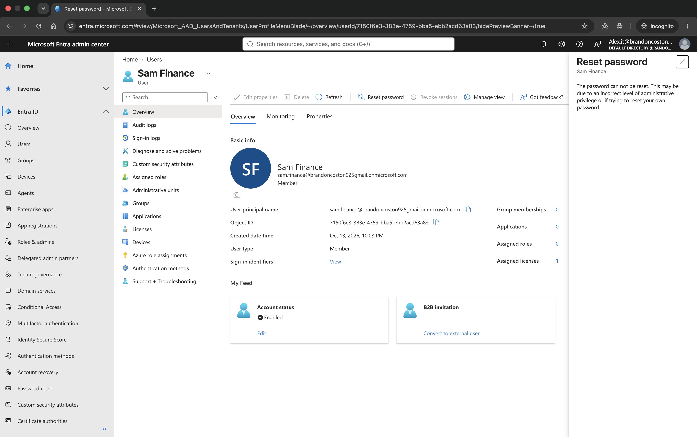
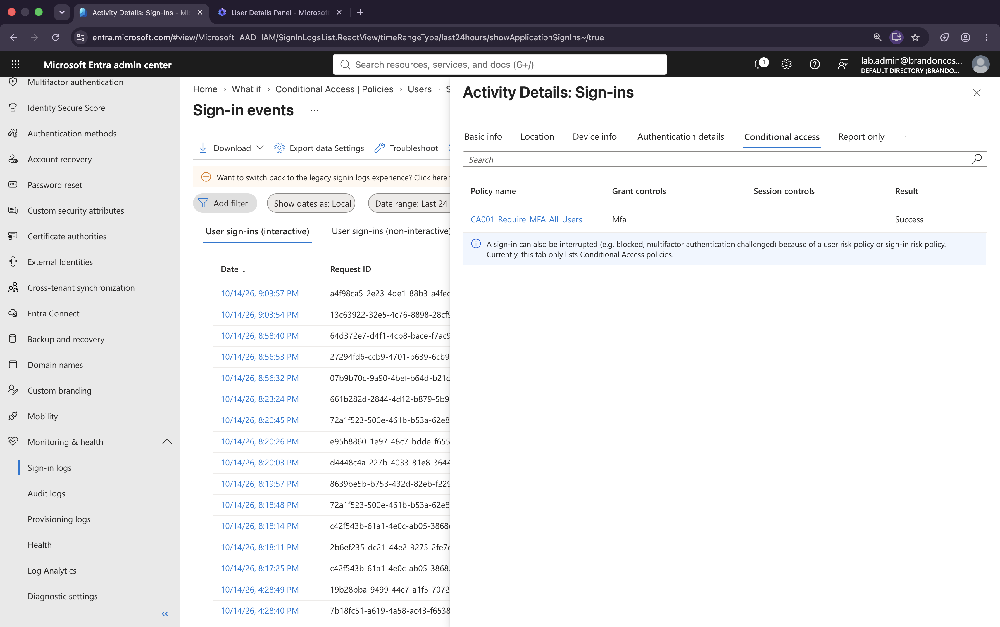
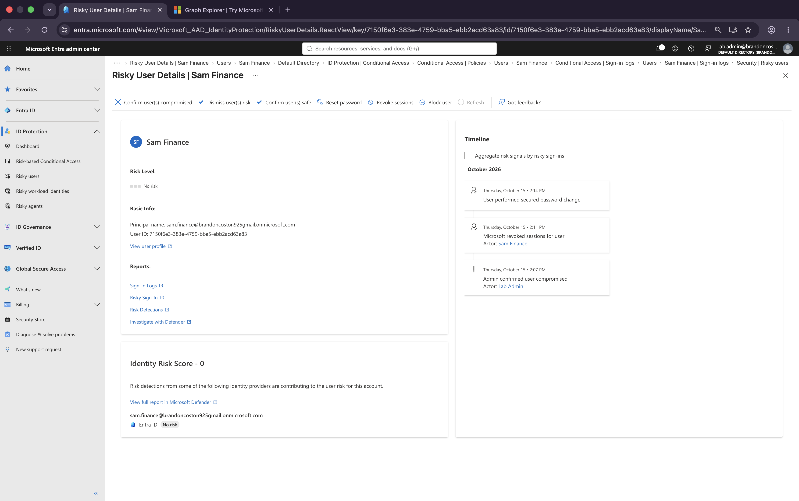

# Microsoft Entra ID — Identity & Access Management Lab

Hands-on identity and access management (IAM) labs built in my own Microsoft Entra ID tenant while preparing for **Microsoft SC-300: Identity and Access Administrator**.

Each lab includes what I built, the problems I hit and how I fixed them, test results, key takeaways, and numbered screenshots.

**Author:** Brandon Coston — AWS Certified Solutions Architect – Associate · AWS Certified Cloud Practitioner · Google Cybersecurity Certificate
[brandoncoston.tech](https://brandoncoston.tech) · [github.com/mmcos925-prog](https://github.com/mmcos925-prog)

---

## Labs

| # | Lab | What it covers |
|---|---|---|
| 1a | [Users, Groups, Licensing & Dynamic Membership](labs/lab1a-users-groups-licensing.md) | Tenant setup, test users, assigned vs. dynamic groups, Entra ID P2 licensing, Azure RBAC inheritance |
| 1b | [Roles & Administrative Units](labs/lab1b-roles-admin-units.md) | Directory-scoped vs. AU-scoped admin roles; Helpdesk Administrator limited to one department |
| 2a | [MFA, SSPR & Password Protection](labs/lab2a-mfa-sspr-password-protection.md) | Authentication methods policy, passkeys, Temporary Access Pass onboarding, self-service password reset, banned passwords, smart lockout |
| 2b | [Conditional Access & Break-Glass Accounts](labs/lab2b-conditional-access.md) | Replacing Security defaults, emergency-access account, MFA for all users, Report-only mode, What If tool, sign-in log verification |
| 3 | [Identity Protection & Risk-Based Access](labs/lab3-identity-protection.md) | Sign-in and user risk policies, simulated anonymous-IP sign-in, Microsoft Graph `confirmCompromised`, self-remediation and session revocation |
| 4 | [Application Integration: SAML SSO, App Registrations & Consent](labs/lab4-app-integration.md) | SAML single sign-on, assignment-required apps (AADSTS50105), delegated vs. application permissions, admin consent, user consent lockdown, admin consent workflow |

**Coming next:** entitlement management, access reviews, Privileged Identity Management (PIM), and monitoring with Log Analytics.

---

## Skills Demonstrated

- **Identity lifecycle:** users, assigned and dynamic groups, attribute-based membership, group-based licensing
- **Least privilege:** Entra admin roles, Administrative Units, separation of Entra roles and Azure RBAC
- **Authentication:** Microsoft Authenticator, passkeys (FIDO2), Temporary Access Pass, SSPR, password protection
- **Conditional Access:** policy design, exclusions, Report-only rollout, What If simulation, lockout prevention
- **Identity Protection:** sign-in risk vs. user risk, risk-based policies, risk investigation and remediation
- **Troubleshooting:** sign-in logs, Conditional Access results, risk reports and user risk timelines
- **Application access:** SAML SSO, app assignment, app registrations, delegated vs. application permissions, consent governance
- **Automation:** Microsoft Graph API (Graph Explorer)

---

## Highlights

**Scoped admin access works as designed.** A Helpdesk Administrator scoped to the HR Administrative Unit can reset an HR user's password but is blocked from resetting a Finance user's password.



**Conditional Access verified in the sign-in logs.** After a Report-only rollout and What If testing, the MFA policy was enforced and confirmed on a real sign-in.



**End-to-end compromised-user response.** A user was confirmed compromised through Microsoft Graph, Entra revoked their sessions, and the user-risk policy forced MFA and a secure password change, returning the account to no risk.



---

## Problems I Solved

| Problem | Root cause | Fix |
|---|---|---|
| Couldn't start the P2 trial | Personal Microsoft account acts like an external identity in its own tenant | Created a tenant-native Global Admin and started the trial from Billing → Trials |
| License assignment failed | User had no **usage location** | Set usage location, then assigned licenses |
| Dynamic group had 0 members | Department attribute didn't match the rule | Fixed the attribute and confirmed with **Validate Rules** |
| Scoped admin could reset an out-of-scope user | Test was run as the Global Admin | Retested in a separate session as the scoped admin |
| CA policy warned about lockout | Policy applied to the signed-in admin | Kept the admin in scope (MFA registered) and excluded only the break-glass group |
| Risk reports lagged behind | Reports populate later than sign-in logs | Verified the policy result in the sign-in log's Conditional Access tab first |
| No portal option to confirm a user compromised | User had no existing risk | Used Microsoft Graph `confirmCompromised` |
| SAML app didn't complete sign-in | Service provider didn't consume the assertion | Proved the IdP side worked with a **Success** sign-in log and isolated the fault to the app |

---

## Environment

- Microsoft Entra ID tenant with an **Entra ID P2** trial
- Microsoft Entra admin center, Microsoft 365 admin center, Azure portal
- Microsoft Graph Explorer
- Test identities: `lab.admin` (Global Administrator), Alex IT, Jordan HR, Sam Finance, and an emergency-access account
- Study resource: John Savill's SC-300 study cram

---

## Repository Layout

```
entra-id-iam-lab/
├── README.md
├── labs/            # One write-up per lab
└── screenshots/     # Numbered screenshots, one folder per lab
```
